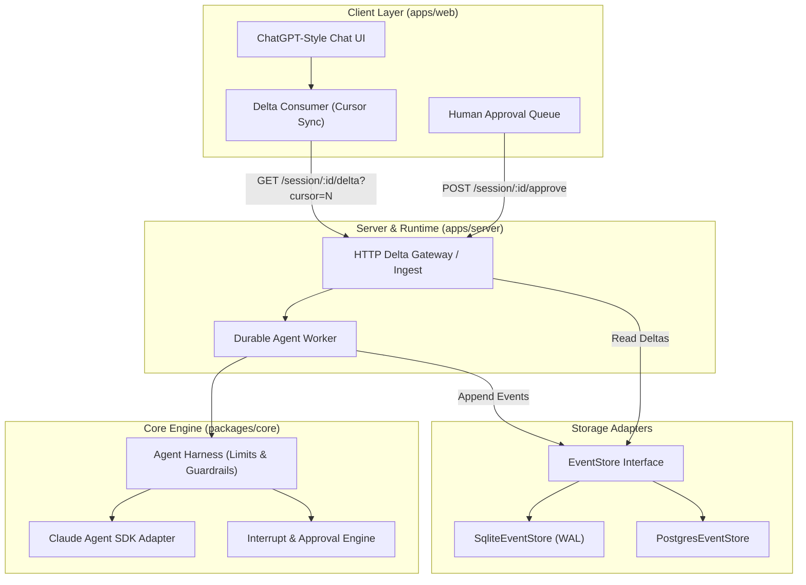

# OpenAgents Architecture Specification

OpenAgents is an opinionated, production-grade agent runtime, test harness, and control plane. It is built to bridge the gap between frontier agent SDKs (starting with the Claude Agent SDK) and enterprise production deployments.

---

## 1. Core Principles

### 1.1 "Build Nothing Without a Harness"
Agents are non-deterministic, long-running, and prone to compounding error rates. Deploying them without a test harness is hazardous. In OpenAgents:
- Every agent runs inside a bounded **Harness** enforcing token budgets, step limits, wall-clock timeouts, and tool permission gates.
- Every run produces an **immutable, append-only event log** enabling 100% deterministic replay and time-travel debugging.
- Built-in evaluation suites allow regression testing against agent workflows before code merges.

### 1.2 "Beyond Request/Response" (Durable Execution)
Traditional synchronous HTTP request/response (`POST /agent/chat` $\rightarrow$ wait 60s $\rightarrow$ `200 OK`) fails for autonomous agents. OpenAgents uses an asynchronous, event-driven model:
- The agent loop executes independently inside durable background workers.
- The web client interacts via a **blind delta-sync transport**: clients request events after a monotonic cursor (`cursor=N`). The backend delivers unconsumed deltas and continues live streaming.
- If a client disconnects, sleeps, or refreshes, no work is lost. Reconnecting with the last cursor catches up instantly.
- Human-in-the-loop interrupts (e.g. approval required for sensitive actions) persist the agent in a `Suspended` state until resumed.

### 1.3 Bedrock of Ports & Adapters (Hexagonal Architecture)
Every critical subsystem is decoupled behind clean interfaces:
- **Persistence (`EventStore`)**: `SqliteEventStore` (zero-config local WAL) $\leftrightarrow$ `PostgresEventStore` (enterprise production with `LISTEN/NOTIFY`).
- **Engine (`AgentHarness`)**: `ClaudeAgentHarness` (Claude Agent SDK) $\leftrightarrow$ future `CopilotHarness`, `CodexHarness`, and `MockAgentHarness` (instant unit testing).
- **Transport (`ClientSync`)**: `DeltaStreamTransport` (cursor-based long-poll/chunked HTTP) $\leftrightarrow$ Redis-backed distributed pub/sub.
- **Tools (`ToolRegistry`)**: In-process TypeScript functions (Zod schemas) $\leftrightarrow$ MCP (Model Context Protocol) servers.

---

## 2. High-Level Architecture



---

## 3. Monorepo Structure

We use a pnpm + Turborepo monorepo:

```
open-agents/
├── packages/
│   ├── core/                    # @open-agents/core
│   │   ├── src/
│   │   │   ├── harness/         # Harness boundaries, budgets, replay, evals
│   │   │   ├── events/          # Event schema, cursor types, event emitters
│   │   │   ├── store/           # EventStore port + Sqlite & Memory adapters
│   │   │   ├── adapters/        # Claude Agent SDK harness adapter
│   │   │   ├── tools/           # Zod tool definitions & MCP client integration
│   │   │   └── types/           # Shared domain types
│   │   └── test/                # Unit test suites
│   │
│   └── sdk/                     # @open-agents/sdk (Client-side TS SDK)
│       └── src/                 # Delta-poller, auto-reconnect, approval hooks
│
├── apps/
│   ├── server/                  # @open-agents/server (Fastify/Node.js)
│   │   ├── src/
│   │   │   ├── routes/          # /sessions, /delta, /approve endpoints
│   │   │   ├── workers/         # Background agent runner loop
│   │   │   └── config/          # Environment & storage selection
│   │   └── Dockerfile
│   │
│   └── web/                     # @open-agents/web (Next.js/React + Tailwind)
│       ├── src/
│       │   ├── components/      # Chat feed, message blocks, approval dialogs
│       │   ├── hooks/           # useAgentSession (delta sync hook)
│       │   └── pages/           # Chat interface & session sidebar
│       └── Dockerfile
│
├── docker-compose.yml           # Turnkey local/cloud deployment
├── package.json                 # Monorepo root configuration
├── pnpm-workspace.yaml          # Workspace configuration
└── turbo.json                   # Build and task pipeline
```

---

## 4. The Durable Delta Transport Protocol

The communication protocol between client and server replaces fragile WebSockets with an offset-driven cursor sync:

### 4.1 Monotonic Event Schema
Every event emitted by an agent is indexed with a strictly increasing sequence integer (`offset`):

```ts
export interface AgentEvent {
  offset: number;                  // Monotonic index (0, 1, 2, ...)
  sessionId: string;               // Session identifier
  timestamp: number;               // Epoch millisecond timestamp
  type: 
    | 'agent:started'
    | 'agent:thought'
    | 'tool:called'
    | 'tool:result'
    | 'agent:suspended'            // Waiting on human approval
    | 'agent:resumed'              // Human approval resolved
    | 'agent:message'              // Output text token/chunk
    | 'agent:completed'
    | 'agent:failed';
  payload: Record<string, unknown>;
}
```

### 4.2 Blind Delta Request Flow
1. **Send Prompt**: Client sends `POST /api/sessions/:id/messages` with `{ content: "..." }`. Server queues the task and responds immediately with `202 Accepted`.
2. **Delta Consumption**: Client calls `GET /api/sessions/:id/delta?cursor=3`.
3. **Delta Response**:
   - If events with `offset > 3` exist in `EventStore`, server immediately flushes them.
   - If the agent is still running, server keeps the HTTP chunked stream open, pushing subsequent events as they are committed.
   - If the connection drops at `offset=7`, client simply reconnects with `cursor=7`.

---

## 5. The Harness Contract

```ts
export interface HarnessConfig {
  agentId: string;
  limits: {
    maxSteps: number;              // Hard ceiling on tool execution loops
    maxTokens: number;             // Cumulative token budget
    timeoutMs: number;             // Wall-clock execution timeout
  };
  approvalGates: Array<{
    toolName: string;
    condition?: (args: Record<string, unknown>) => boolean;
  }>;
}
```

When an agent attempts to execute a tool matching an approval gate:
1. The harness intercepts the call.
2. The harness persists an `agent:suspended` event with an `interruptId` and tool argument preview.
3. Execution pauses and worker state is safely checkpointed.
4. The client UI renders an interactive approval card.
5. The user submits Approve or Reject via `POST /api/sessions/:id/approve`.
6. An `agent:resumed` event is appended, and the worker resumes tool execution.

---

## 6. Deployment & Quickstart

- **Zero-Config Local**:
  ```bash
  pnpm install
  pnpm dev
  ```
  Runs SQLite in WAL mode with zero external services.

- **Production Docker Compose**:
  ```bash
  docker compose up -d
  ```
  Launches:
  - `open-agents-server` (connected to Postgres)
  - `open-agents-web` (accessible at `http://localhost:3000`)
  - `postgres` (persistent storage & event log)
