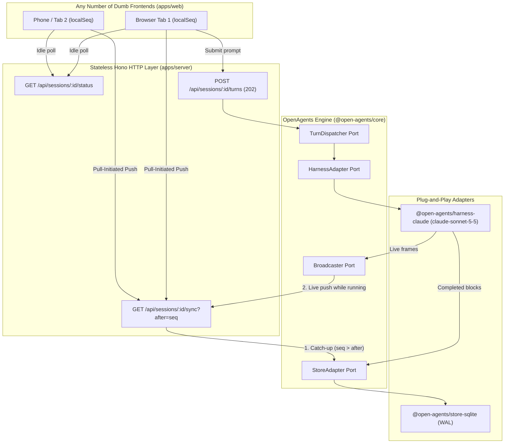

# OpenAgents Architecture

OpenAgents is an opinionated TypeScript agent runtime and turnkey chat platform built around two core theses:
1. **Build nothing without a frontier Agent Harness** — never hand-roll brittle DIY agent loops when battle-tested SDK harnesses exist (`@anthropic-ai/claude-agent-sdk` today, with GitHub Copilot SDK and OpenAI Codex App Server SDK next).
2. **Agentic AI is not synchronous request/response (and doesn't need brittle WebSockets)** — backend execution is decoupled and durable, while any number of stateless "dumb" frontends tune in via **Pull-Initiated Push** and lightweight idle status polling.

---

## 1. Core Architectural Decisions

### 1.1 Frontier Agent Harnesses as Adapters
Frontier agent SDKs (`@anthropic-ai/claude-agent-sdk`, `@github/copilot-sdk`, `codex app-server`) already manage LLM context compaction, built-in file/bash/web/MCP tools, and native session transcripts on disk. OpenAgents wraps each harness behind a single `HarnessAdapter` port:
- **Context stays native**: OpenAgents stores the harness's native session identifier (`harnessSessionId`) and resumes subsequent turns natively (e.g., `options: { resume: harnessSessionId }` in Claude Agent SDK).
- **Authoritative discrete blocks (no token-delta spam)**: Harnesses run with partial token deltas disabled (`includePartialMessages: false`). Every persisted item is a complete, meaningful unit of work (`user_message`, `thinking`, `tool_use`, `tool_result`, `assistant_message`, `turn_result`)—typically 5–20 rows per turn rather than thousands of 2-character fragments.
- **Isolated workspaces**: Each session executes inside its own sandboxed working directory (`workspaces/<sessionId>`) by default, or an explicitly configured path/volume.

### 1.2 Stateless Backend + "Radio Broadcast" Dumb Frontends
OpenAgents treats the backend like a broadcast station with a durable tape recorder, and every browser tab or device as a dumb radio receiver:
- **Zero per-client state on the server**: The HTTP server tracks zero client sessions or per-tab watermarks in RAM. Every sync request simply passes `?after=<seq>`.
- **Unlimited simultaneous viewers**: 1 tab or 50 tabs across laptop, phone, and teammates can watch the exact same session simultaneously without destructive queue reads or socket coordination.
- **Pull-Initiated Push (`GET /api/sessions/:id/sync?after=<seq>`)**:
  1. **Catch-Up (Pull)**: Server reads all blocks with `seq > after` from the store and flushes them immediately as NDJSON lines.
  2. **Live Broadcast (Conditional Push)**:
     - If the session is `idle` or `error`, the server writes a terminal `done` frame and **closes the HTTP response immediately**—leaving zero idle open connections.
     - If the session is `running`, that same HTTP response stays open, broadcasting each newly completed block (`seq = N+1, N+2...`) as the harness emits it, and closes cleanly the moment `turn_result` lands.
  3. **Race-free handoff**: The sync handler subscribes to the broadcast channel *before* querying `getBlocksAfter(after)` and deduplicates via a monotonic `highWaterMark`, guaranteeing zero missed or duplicated blocks between catch-up and live streaming.
  4. **Idle tabs**: While `idle`, tabs poll a tiny `GET /api/sessions/:id/status` endpoint (`{ status, latestSeq }`). If another tab starts a turn (bumping `status` to `'running'` or advancing `latestSeq`), every passive tab automatically initiates `/sync?after=<localSeq>` and joins the live broadcast.

### 1.3 Plug-and-Play Ports & Adapters (Hexagonal Bedrock)
`@open-agents/core` is pure, zero-native-dependency TypeScript defining three adapter ports:

| Port | Responsibility | Quickstart Adapter | Enterprise / Scale Path |
|---|---|---|---|
| `HarnessAdapter` | Executes an agent turn inside `cwd` and yields normalized `BlockPayload` items | `@open-agents/harness-claude` (`claude-sonnet-5-5`, `bypassPermissions`) | `@open-agents/harness-copilot`, `@open-agents/harness-codex` |
| `StoreAdapter` | Persists `Session` metadata and monotonic `seq` `SessionBlock` records | `@open-agents/store-sqlite` (WAL mode) / `MemoryStore` (tests) | `@open-agents/store-postgres` |
| `TurnDispatcherAdapter` & `BroadcasterAdapter` | Enqueues background turn jobs and fans out live frames to active `/sync` streams | `InProcessTurnDispatcher` + `InMemoryBroadcaster` | BullMQ / Redis / Postgres `LISTEN/NOTIFY` (decoupled API pods & worker pods) |

---

## 2. System Topology



---

## 3. Monorepo Layout

```text
open-agents/
├── packages/
│   ├── core/                  # @open-agents/core — pure TS ports, engine, Web-Standard HTTP handler
│   ├── store-sqlite/          # @open-agents/store-sqlite — SQLite WAL StoreAdapter
│   └── harness-claude/        # @open-agents/harness-claude — Claude Agent SDK adapter
├── apps/
│   ├── server/                # @open-agents/server — Single-port Hono server (/api/* + static SPA)
│   └── web/                   # @open-agents/web — Turnkey ChatGPT-style React + Tailwind SPA
├── .github/workflows/ci.yml   # Automated tests + multi-arch GHCR container publishing
├── Dockerfile                 # Unified single-image build (UI + API on port 3000)
├── docker-compose.yml         # One-command full-stack container deployment
├── pnpm-workspace.yaml
├── turbo.json
└── tsconfig.base.json
```

---

## 4. Domain & Wire Contracts

### 4.1 Normalized `SessionBlock`
Every record persisted in `StoreAdapter` and streamed over `/sync` shares one immutable envelope:

```ts
export interface SessionBlock {
  seq: number;        // 1-indexed strictly monotonic per session
  id: string;
  sessionId: string;
  turnId: string;
  createdAt: string;  // ISO 8601
  payload:
    | { kind: 'user_message'; text: string }
    | { kind: 'thinking'; thinking: string }
    | { kind: 'assistant_message'; text: string }
    | { kind: 'tool_use'; toolUseId: string; toolName: string; input: unknown }
    | { kind: 'tool_result'; toolUseId: string; toolName?: string; output: string; isError: boolean }
    | {
        kind: 'turn_result';
        outcome: 'completed' | 'aborted' | 'error';
        durationMs: number;
        costUsd?: number;
        inputTokens?: number;
        outputTokens?: number;
        errorMessage?: string;
      };
}
```

### 4.2 HTTP API Surface (`apps/server`)

| Method & Path | Response | Purpose |
|---|---|---|
| `GET /api/health` | `200 JSON` | Server liveness and registered harness adapters |
| `GET /api/harnesses` | `200 JSON` | Available harnesses (`id`, `displayName`, `defaultModel`) |
| `GET /api/sessions` | `200 JSON` | List sessions ordered by `updatedAt DESC` |
| `POST /api/sessions` | `201 JSON` | Create session (`harnessId?`, `model?`, `cwd?`, `title?`) |
| `GET /api/sessions/:id` | `200 JSON` | Session metadata |
| `DELETE /api/sessions/:id` | `204` | Delete session and blocks |
| `GET /api/sessions/:id/status` | `200 JSON` | `{ id, status, latestSeq, updatedAt }` for lightweight idle polling |
| `POST /api/sessions/:id/turns` | `202 JSON` | Append `user_message` block and dispatch background harness turn |
| `POST /api/sessions/:id/abort` | `200 JSON` | Trigger `AbortController` on an active turn |
| `GET /api/sessions/:id/sync?after=N` | `200 NDJSON` | Pull-initiated push stream (`{"type":"block",...}` lines + terminal `{"type":"done",...}`) |
