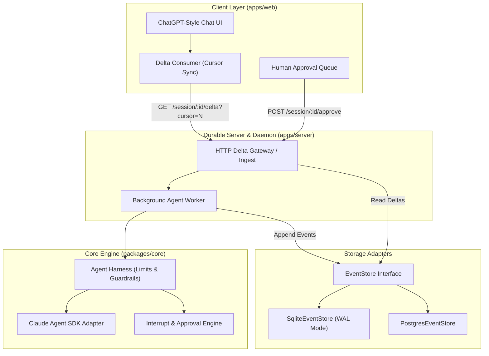

<div align="center">

# 🤖 OpenAgents

**The opinionated, durable runtime, test harness, and turnkey control plane for frontier AI agents.**

[](https://www.typescriptlang.org/)
[](https://turbo.build/)
[](https://vitest.dev/)
[](https://docker.com)
[](LICENSE)

*Built for engineers who know that AI agents are not "just another CRUD app".*

</div>

---

## ⚡ The Thesis: Why OpenAgents?

The entire tech industry is chasing agentic AI, yet production deployments are plagued with failures:
- **Toy Framework Traps**: Frameworks that invent home-grown, brittle agent loops rather than harnessing frontier lab SDKs (like the Claude Agent SDK).
- **Request/Response is Dead**: HTTP request/response (`POST /agent/chat` $\rightarrow$ wait 60s $\rightarrow$ `200 OK`) fails for multi-minute, autonomous workflows. When a browser tab sleeps or a socket drops, the entire run crashes.
- **No Harness, No Safety**: Running non-deterministic LLMs in production without execution boundaries, step limits, token budgets, and regression test suites is a recipe for catastrophic failure.

**OpenAgents is built on three core engineering opinions:**

1. **"Build Nothing Without a Harness"**: Agents run inside strict boundaries (`maxSteps`, `maxTokens`, `timeoutMs`). Every step is committed to an immutable append-only event log for deterministic replay and regression testing.
2. **"Durable Delta Transport"**: No fragile WebSockets. Clients request deltas blindly by monotonic cursor (`offset=N`). The backend executes tasks in durable background workers, flushes deltas immediately, and keeps streams alive. Disconnects and refreshes never lose a token.
3. **"Bedrock of Ports & Adapters"**: Pure Hexagonal Architecture. Swap storage (`SQLite` $\leftrightarrow$ `Postgres`), engines (`Claude Agent SDK` $\leftrightarrow$ `Copilot SDK` $\leftrightarrow$ `Mock`), and tools seamlessly.

---

## 🏛️ Architecture Overview



---

## 🚀 Quickstart

### 1. One-Click Docker Compose (Turnkey Platform)
Boot the entire platform—server, worker daemon, and ChatGPT-style web UI—in one command:

```bash
docker compose up -d
```
Open **[http://localhost:3000](http://localhost:3000)** in your browser!

---

### 2. Local Monorepo Development (Zero-Config SQLite)

Clone and install dependencies:
```bash
git clone https://github.com/agentic-girl/open-agents.git
cd open-agents
pnpm install
```

Run tests across all packages:
```bash
pnpm test
```

Start the Server and Web UI simultaneously:
```bash
pnpm dev
```
- **Web UI**: `http://localhost:3000`
- **Server API**: `http://localhost:3001`
- **Health check**: `http://localhost:3001/health`

---

## 📦 Using the Core Library (`@open-agents/core`)

You can import `@open-agents/core` directly into any backend service or script:

```ts
import { ClaudeAgentHarness, SqliteEventStore, defineTool } from '@open-agents/core';
import { z } from 'zod';

// 1. Initialize persistent event store
const store = new SqliteEventStore({ dbPath: 'agent-events.db' });

// 2. Define type-safe tools with Zod
const deployTool = defineTool({
  name: 'deployService',
  description: 'Deploy container to environment',
  parameters: z.object({
    service: z.string(),
    environment: z.enum(['staging', 'production']),
  }),
  execute: async ({ service, environment }) => {
    return { status: 'deployed', service, environment };
  },
});

// 3. Configure the Harness with hard limits and human-in-the-loop gates
const harness = new ClaudeAgentHarness(
  {
    agentId: 'ops-engineer',
    instructions: 'You are an autonomous DevOps assistant.',
    tools: [deployTool],
    limits: {
      maxSteps: 10,
      maxTokens: 50_000,
      timeoutMs: 120_000,
    },
    // Require human approval before touching production!
    approvalRules: [
      {
        toolName: 'deployService',
        condition: (args) => args.environment === 'production',
        message: 'Production deployments require human approval.',
      },
    ],
  },
  store,
);

// 4. Run an agent task
const result = await harness.run({
  sessionId: 'session-deploy-1',
  prompt: 'Deploy payment-gateway to production',
});

if (result.status === 'suspended') {
  console.log('⏸️ Agent suspended! Waiting for human operator approval.');
}
```

---

## ⚖️ How OpenAgents Compares

| Feature | Typical Frameworks (LangChain, CrewAI) | OpenAgents |
|---|---|---|
| **Execution Model** | Synchronous request/response (blocks thread) | **Asynchronous Durable Background Workers** |
| **Transport** | Brittle WebSockets (drops connection on sleep) | **Durable Delta-Sync** (cursor-based resume) |
| **Harness & Bounds** | None (runs unbounded while-loops) | **Strict limits** (`maxSteps`, `maxTokens`, `timeoutMs`) |
| **Frontier Engine** | Re-invents custom prompt loops | **Harnesses official Claude Agent SDK** |
| **Human Approvals** | Clunky CLI `input()` prompts | **First-class Interrupts** with turnkey UI approvals |
| **Persistence** | In-memory or tacked-on ORMs | **Append-only EventStore (SQLite WAL / Postgres)** |
| **Testability** | Hard to mock without live API keys | **Deterministic Mock Harness & Vitest test suites** |

---

## 🗺️ Roadmap

- [x] Monorepo scaffold with Turborepo, pnpm & strict TypeScript
- [x] Ports & Adapters Architecture (`EventStore`, `AgentHarness`, `ToolRegistry`)
- [x] In-memory & SQLite WAL EventStore with monotonic offsets
- [x] Base Harness with token/step/time limits and human-in-the-loop interrupt engine
- [x] Official Claude Agent SDK adapter with automated Zod tool schema conversion
- [x] Deterministic Mock Harness for instant testing without API credits
- [x] Fastify-based durable delta-sync streaming server
- [x] ChatGPT/LibreChat-style turnkey Web UI with live delta consumer & approval cards
- [x] Turnkey Docker Compose orchestration
- [ ] GitHub Copilot SDK harness adapter
- [ ] OpenAI Codex App Server SDK harness adapter
- [ ] Postgres + `LISTEN/NOTIFY` distributed event store adapter
- [ ] MCP (Model Context Protocol) remote server client integration

---

## 📄 License

MIT © [OpenAgents Contributors](LICENSE)
