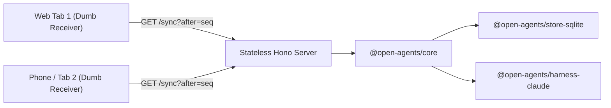

<div align="center">

# OpenAgents

**An opinionated, durable TypeScript runtime and turnkey UI built on frontier Agent Harnesses.**

[](https://www.typescriptlang.org/)
[](https://hono.dev/)
[](https://www.docker.com/)
[](LICENSE)

</div>

---

## Why OpenAgents?

Most agent projects fail in production for two reasons:
1. **They treat agents like standard request/response CRUD apps** (or rely on stateful WebSockets that shatter when a laptop sleeps, a proxy times out, or a container redeploys).
2. **They hand-roll DIY `while`-loops around raw LLM endpoints** instead of building on battle-tested frontier **Agent Harnesses** that already solve context compaction, file/shell/MCP tools, and native session transcripts.

**OpenAgents takes a strictly opinionated approach:**
- **Harness-First**: Plugs directly into official frontier agent harnesses—starting with **`@anthropic-ai/claude-agent-sdk`** (`claude-sonnet-5-5` in `bypassPermissions` mode), with **GitHub Copilot SDK** and **OpenAI Codex App Server** adapters planned next.
- **Pull-Initiated Push ("Radio Broadcast" Transport)**: Zero WebSockets and zero idle open sockets. A stateless Hono backend writes discrete, completed agent blocks (`thinking`, `tool_use`, `tool_result`, `assistant_message`) to a monotonic log. Any number of "dumb" frontends—across browser tabs, phones, or teammates—can tune in at any point via `?after=<seq>`, catch up instantly from disk, stream live updates until the turn ends, and survive refreshes or disconnects with zero lost work.
- **Plug-and-Play Ports & Adapters**: `@open-agents/core` is pure, zero-bloat TypeScript. Storage (`SQLite` quickstart $\leftrightarrow$ `Postgres`), Harnesses (`Claude` $\leftrightarrow$ `Copilot` $\leftrightarrow$ `Codex`), and Job Dispatch (`In-Process` $\leftrightarrow$ `Redis / BullMQ`) are cleanly decoupled packages.

---

## Architecture at a Glance



See [ARCHITECTURE.md](ARCHITECTURE.md) for the full transport specification, sequence watermarks, and adapter interfaces.

---

## Quickstart

### Prerequisites
- **Node.js 22+** and **pnpm** (or **Docker**)
- An `ANTHROPIC_API_KEY` in `.env`

```bash
cp .env.example .env
# Add your ANTHROPIC_API_KEY to .env
```

### Option A: Docker Compose (Turnkey)

```bash
docker compose up --build
```

Open **[http://localhost:3000](http://localhost:3000)**—try opening two browser tabs side-by-side on the same session and watch both receive the live agent broadcast simultaneously.

### Option B: Local Monorepo Development (SQLite Quickstart)

```bash
pnpm install
pnpm build
pnpm dev
```

- **Web UI**: `http://localhost:3000`
- **Hono API**: `http://localhost:3001/api/health`

---

## Programmatic Usage (`@open-agents/core`)

Every layer is usable standalone as a clean TypeScript SDK without the web UI:

```ts
import { OpenAgentsEngine } from '@open-agents/core';
import { ClaudeHarnessAdapter } from '@open-agents/harness-claude';
import { SqliteStoreAdapter } from '@open-agents/store-sqlite';

const engine = new OpenAgentsEngine({
  store: new SqliteStoreAdapter({ dbPath: './open-agents.db' }),
  harnesses: [
    new ClaudeHarnessAdapter({
      defaultModel: 'claude-sonnet-5-5',
    }),
  ],
  workspaceRoot: './workspaces',
});

const session = await engine.createSession({ harnessId: 'claude' });
await engine.submitTurn(session.id, 'Inspect this directory and create a hello.ts script.');

// Read completed blocks from any cursor
const blocks = await engine.getBlocksAfter(session.id, 0);
console.log(blocks);
```

---

## Monorepo Packages

| Package | Description |
|---|---|
| `packages/core` (`@open-agents/core`) | Zero-dependency TypeScript ports, normalized block protocol, in-memory adapters, and `OpenAgentsEngine` |
| `packages/harness-claude` (`@open-agents/harness-claude`) | Official `@anthropic-ai/claude-agent-sdk` harness adapter (`claude-sonnet-5-5`, `bypassPermissions`, native `resume` multi-turn continuity) |
| `packages/store-sqlite` (`@open-agents/store-sqlite`) | Zero-config SQLite WAL `StoreAdapter` |
| `apps/server` (`@open-agents/server`) | Stateless Hono HTTP API implementing Pull-Initiated Push NDJSON streaming |
| `apps/web` (`@open-agents/web`) | Turnkey ChatGPT/LibreChat-style React + Tailwind frontend |

---

## Roadmap

- [x] `@open-agents/core` hexagonal ports (`HarnessAdapter`, `StoreAdapter`, `TurnDispatcherAdapter`, `BroadcasterAdapter`)
- [x] `@open-agents/harness-claude` (`@anthropic-ai/claude-agent-sdk`, `claude-sonnet-5-5`, `bypassPermissions`, multi-turn `resume`)
- [x] `@open-agents/store-sqlite` (WAL mode, atomic sequence watermarks)
- [x] Stateless Hono server with race-free Pull-Initiated Push (`GET /api/sessions/:id/sync?after=<seq>`)
- [x] Turnkey ChatGPT-style React UI + multi-tab broadcast sync + `docker compose up`
- [ ] `@open-agents/harness-copilot` (`@github/copilot-sdk`)
- [ ] `@open-agents/harness-codex` (`codex app-server` JSON-RPC)
- [ ] `@open-agents/store-postgres` + `LISTEN/NOTIFY` & distributed queue adapter

---

## License

[MIT](LICENSE)
